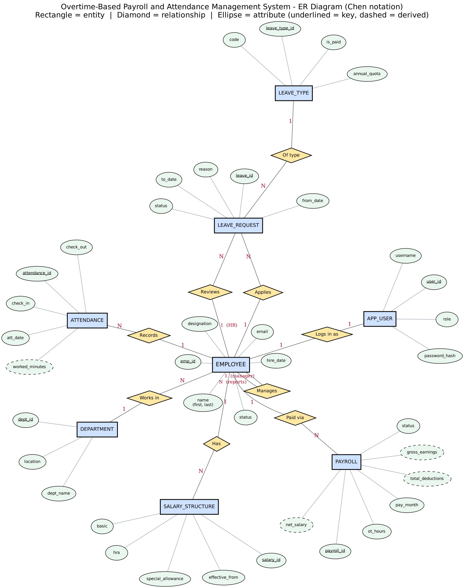

# Overtime-Based Payroll and Attendance Management System

DBMS Capstone Project (Semester 3, BTech CSE AI&ML, KR Mangalam University).
Topic #11 from the capstone list.

A MySQL database for a mid-sized IT company (*TechSphere Solutions*, fictional). It records daily check-in and
check-out, works out regular and overtime hours, handles leave and approvals, and generates monthly payroll
with salary slips, overtime summaries, attendance reports and payroll expenditure statements. A Python
command-line app gives **HR Admins** and **Employees** separate, role-based menus.

## The five capstone phases → where each is delivered

| Phase | Requirement | Delivered in |
|---|---|---|
| 1. Data modelling & schema | ER diagram with cardinalities, 3NF, PK/FK schema | `sql/01_schema.sql`, `docs/er_diagram_chen.png`, report section 2 (normalisation proof) |
| 2. Procedural implementation | DDL, salary & tax procedures/functions, validation triggers, 10+ employees over 3 months | `sql/02_functions.sql`, `sql/04_procedures.sql`, `sql/05_triggers.sql`, `sql/06_seed_data.sql` (12 employees, Aug–Nov 2026) |
| 3. Query & report development | monthly attendance, salary slip, late-marks reports; indexes with before/after plans | `sql/03_views.sql`, `sql/09_index_optimization.sql`, `docs/output/index_optimization_results.txt` |
| 4. Security, access control & testing | RBAC (HR vs employee), COMMIT/ROLLBACK, valid/invalid/boundary tests documented | `sql/07_security.sql`, `tests/run_tests.py`, `tests/test_results.md` (57/57 pass) |
| 5. Integration, UI & presentation | role-based CLI on the same backend, README, screenshots, report | `app/payroll_app.py`, `docs/screenshots/`, `docs/Capstone_Report_Shivom_Sood.pdf` |

Everything runs as **one connected application** on one database (`payroll_db`), built by one script.

## Folder structure

```
payroll-attendance-system/
├── setup.sh                     builds the whole database in one go
├── sql/
│   ├── 01_schema.sql            tables, constraints, indexes (DDL)
│   ├── 02_functions.sql         working days, overtime, income tax, TDS
│   ├── 03_views.sql             daily classification + all reports
│   ├── 04_procedures.sql        check-in/out, leave, payroll run, salary slip (with transactions)
│   ├── 05_triggers.sql          integrity rules + audit trail
│   ├── 06_seed_data.sql         12 employees, Aug–Nov 2026 attendance, 3 months of payroll
│   ├── 07_security.sql          roles, users, row-level self-service views (DCL)
│   ├── 08_demo_queries.sql      13 viva queries (joins, subqueries, CTEs, windows…)
│   └── 09_index_optimization.sql  execution plan before/after experiment
├── app/payroll_app.py           Python CLI (HR + Employee menus)
├── tests/
│   ├── run_tests.py             57 valid / invalid / boundary test cases
│   └── test_results.md          documented results
├── tools/                       seed generator, screenshot capture, report builder
└── docs/
    ├── Capstone_Report_Shivom_Sood.pdf
    ├── er_diagram_chen.png, architecture.png
    ├── screenshots/             real output from the app and MySQL
    └── output/                  raw text traces
```

## Setup (Mac, MySQL via Homebrew)

```bash
brew services start mysql                 # make sure MySQL is running
pip3 install mysql-connector-python       # Python driver
cd payroll-attendance-system
./setup.sh                                # asks for MySQL root password (Enter if none)
python3 app/payroll_app.py
```

Using MySQL Workbench instead? Open and run the files `01` to `07` in order, then `08` for the demo queries.

**Demo logins**

| Role | Username | Password |
|---|---|---|
| HR Admin | `neha` (also `aditya`) | `hr@1234` |
| Employee | `rahul`, `priya`, `vikram`, `isha`, … (any first name) | `emp@1234` |

The app connects to MySQL as the limited `payroll_app` account (created by `07_security.sql`). You can
override the connection with `PAYROLL_DB_USER`, `PAYROLL_DB_PASSWORD`, `PAYROLL_DB_HOST` environment variables.

> Sample attendance runs from **1 Aug to 19 Nov 2026**. Working days after that show as *ABSENT* until people
> check in through the app. August and September payroll are **PAID** (locked), October is **PROCESSED**.

## Organisational policy (stored in `payroll_policy`, editable)

| Rule | Value |
|---|---|
| Shift | 09:30, 9 hours including a 1-hour break (540 min) |
| Late mark | check-in after 09:45 (15-minute grace) |
| Every 3 late marks | half-day salary deduction |
| Full / half day | ≥ 8 h worked / ≥ 4 h worked; check-in without check-out counts as half day |
| Weekday overtime | time beyond 9 h, only if ≥ 30 min, capped at 4 h/day, paid at **1.5×** |
| Weekend / holiday work | every hour is overtime (max one shift), paid at **2×** |
| Hourly rate | basic ÷ (working days × 8) |
| Loss of pay | (fixed monthly pay ÷ working days) × LOP days |
| PF | 12 % of earned basic |
| Income tax (TDS) | simplified new regime slabs, ₹75,000 standard deduction, no tax up to ₹12 L taxable (with marginal relief), 4 % cess, projected over 12 months |

## How one month's salary is calculated (`sp_generate_payroll`)

```
fixed pay      = basic + HRA + special allowance          (salary row in force that month)
LOP days       = working days − present days − paid leave days
                 (covers absences, unpaid leave, half days, days before joining)
overtime pay   = hourly rate × (weekday OT hrs × 1.5 + holiday OT hrs × 2)
gross          = fixed pay + overtime pay
deductions     = LOP deduction + late-mark deduction + PF + TDS
net salary     = gross − deductions
```

The procedure refuses to run for a month that has not ended or that is already PAID, and it runs inside a
transaction (all employees succeed or nothing changes). Re-running it replaces the PROCESSED rows, so a
corrected attendance record is reflected in a fresh run.

## ER diagram



Supporting tables not shown in the diagram (no relationships to draw): `payroll_policy`, `tax_slabs`,
`holidays`, `calendar`, `audit_log`.

## Database objects at a glance

* **Tables (13):** departments, employees, salary_structure, payroll_policy, tax_slabs, holidays, calendar,
  attendance, leave_types, leave_requests, payroll, app_users, audit_log
* **Views (14):** v_daily_attendance (core), v_monthly_attendance, v_late_marks, v_overtime_summary,
  v_salary_slip, v_payroll_expenditure, v_leave_requests, v_leave_balance, v_employee_directory, and five
  `v_my_*` self-service views
* **Functions (8):** fn_policy_id, fn_is_working_day, fn_working_days, fn_ot_minutes, fn_annual_tax,
  fn_monthly_tds, fn_salary_id, fn_current_emp_id
* **Procedures (14):** sp_fill_calendar, sp_add_employee, sp_update_salary, sp_check_in, sp_check_out,
  sp_upsert_attendance, sp_apply_leave, sp_review_leave, sp_generate_payroll, sp_mark_payroll_paid,
  sp_salary_slip, sp_my_check_in, sp_my_check_out, sp_my_apply_leave
* **Triggers (9):** attendance validation (active employee, not before joining, not future, not in a paid
  month), no overlapping leave, salary/leave/payroll audit, PAID payroll cannot be updated or deleted

## Testing (Phase 4)

```bash
python3 tests/run_tests.py     # rebuilds the DB, runs 57 cases, writes tests/test_results.md, restores demo data
```

Covers **valid** flows (add employee, check-in/out, leave approval, payroll run), **invalid** input (negative salary,
duplicate attendance, overlapping leave, unauthorised access, locked payroll, SQL injection, rollback) and
**boundary** values (exactly 8 h / 4 h, 09:45:00 vs 09:45:01, 29 vs 30 min overtime, tax at ₹12 lakh, exact leave balance).

## Index optimisation (Phase 3)

`sql/09_index_optimization.sql` runs the late-marks query with and without indexes. On project data the plan goes from
scanning all 853 rows to a range scan of ~231 rows; on a 365,000-row copy, `EXPLAIN ANALYZE` time drops from about
**919 ms → 72 ms (date index) → 19 ms (covering index)**.

## Rules the database enforces (try them in the viva)

| Try this | Result |
|---|---|
| Check in twice on the same day | "Already checked in today" |
| Apply for leave overlapping another request | blocked by trigger |
| Apply for more casual leave than the balance | "Insufficient leave balance" |
| Generate payroll for the current month | "only after the month has ended" |
| Edit or delete August/September payroll | "Paid payroll records are locked" |
| Change attendance in September | "attendance is locked" |
| Employee tries to approve leave | "Only HR admins can review leave" |
| `mysql -u rahul -p'emp@1234' payroll_db -e "SELECT * FROM payroll"` | ERROR 1142, access denied |
| `... -e "SELECT month_label, net_salary FROM v_my_payslips"` | only Rahul's own slips |

## Security design

1. **Application layer:** passwords stored as salted SHA-256 (`app_users`); the menu depends on the role.
   The app's MySQL account (`payroll_app`) can only SELECT and EXECUTE procedures, so every change goes
   through validated stored procedures. All queries use parameters (no SQL injection).
2. **Database layer:** MySQL roles `payroll_hr` and `payroll_employee`. Employees get access only to
   `SQL SECURITY DEFINER` views that filter rows by the connected user (`USER()`), which is row-level
   security in plain MySQL.
3. **Audit trail:** triggers log salary changes, leave decisions and payroll locking with the app username.

*Tax and PF rules are simplified for academic purposes.*
